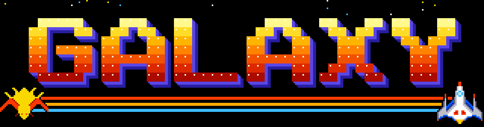
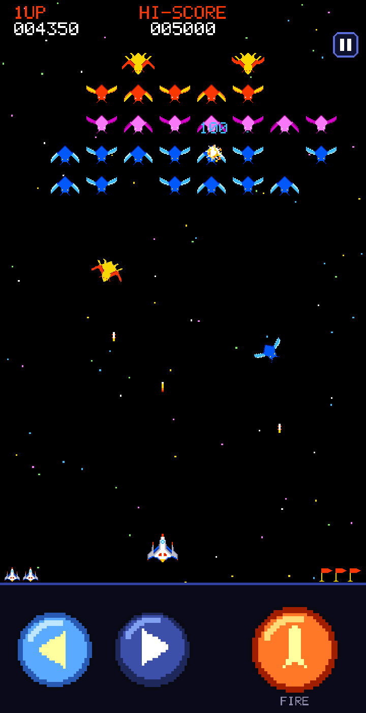
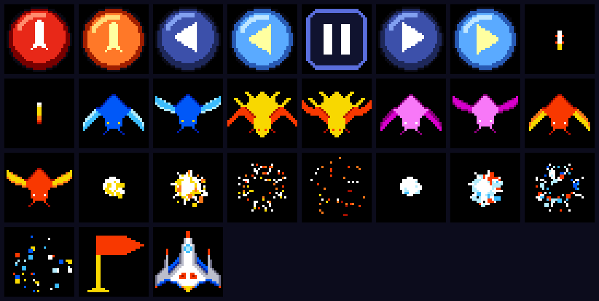
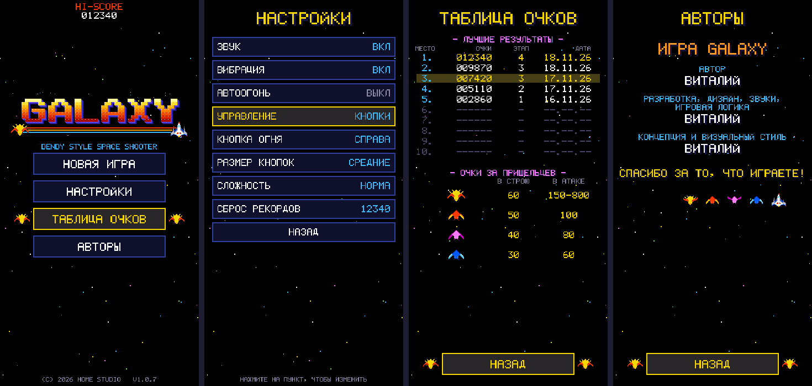

# GALAXY — шутер в стиле Galaxian для Android (Kotlin)

Ремейк классической **«Galaxy» (Galaxian) с Денди / NES**, написанный на чистом Kotlin
поверх `SurfaceView` (без игровых движков и сторонних библиотек).

<p align="center">
  <br>
  
  <br>
  
</p>

## Возможности

* **Загрузочный экран**: логотип, полоса прогресса и летящий вдоль неё корабль. Спрайты действительно грузятся в это время.
* **Титульный экран**: таблица очков (CONVOY / CHARGER), рекорд и мигающая надпись «TAP TO START».
* Строй из 32 пришельцев (флагманы, красные, фиолетовые, синие) раскачивается и машет крыльями.
* Пришельцы выходят из строя петлёй, пикируют на игрока, стреляют, пролетают сквозь низ экрана и возвращаются сверху.
* **Флагман с эскортом**: до 800 очков, если сначала сбить оба сопровождающих.
* Как в оригинале, в полёте может быть только одна ракета, и до выстрела она «сидит» на носу корабля.
* Разноцветное мерцающее звёздное небо, эффект варпа между уровнями, дополнительная жизнь на 7000 очков.
* Рекорд сохраняется (`SharedPreferences`), есть экран паузы.
* 8-битные звуковые эффекты (генерируются скриптом).
* **Спрайты — PNG 32×32** в `app/src/main/assets/sprites/`.

## Меню

* **НОВАЯ ИГРА** — старт.
* **НАСТРОЙКИ** — звук, вибрация, автоогонь, режим управления (кнопки / свайп), кнопка огня справа или слева (для левшей),
  размер кнопок (малые / средние / большие), сложность (легко / норма / сложно), сброс рекордов.
* **ТАБЛИЦА ОЧКОВ** — топ-10 лучших результатов (очки, этап, дата) и стоимость пришельцев. Если результат попал в топ, после GAME OVER таблица открывается сама, а новая строка мигает.
* **АВТОРЫ** — титры с парадом пришельцев. Список редактируется в `Menu.kt` (`credits`).
* **Меню паузы** (кнопка ⏸ или «Назад»): продолжить / настройки / главное меню.

Меню на русском: в пиксельный шрифт 5×7 добавлена кириллица. Управлять меню можно касанием или с клавиатуры/геймпада (вверх/вниз + огонь).

## Управление (сенсорные кнопки)

| Кнопка | Действие |
|---|---|
| ◀ ▶ (слева внизу) | движение корабля; палец можно перетягивать с кнопки на кнопку |
| 🔴 FIRE (справа внизу) | выстрел (если держать — автоогонь) |
| ⏸ (справа вверху) | пауза |
| «Назад» | пауза; в меню — шаг назад |

Мультитач работает, поэтому можно двигаться и стрелять одновременно.

* **Плавный разгон**: короткое касание стрелки сдвигает корабль медленно, удержание разгоняет до полной скорости.
* **Буфер выстрела**: нажатие FIRE чуть раньше, чем ракета освободилась, не теряется.
* **Вибрация** при нажатии кнопок, гибели корабля и получении жизни (отключается в настройках).
* **Режим «Свайп»**: вместо стрелок полоса, по которой водят пальцем, и корабль повторяет движение.
Клавиатура и геймпад тоже поддерживаются (стрелки / A-D, пробел / кнопка A, Start — пауза).

## Сборка на GitHub

Workflow `.github/workflows/android.yml` запускается при каждом push и pull request:

1. Откройте **Actions → Build Android APK** → последний запуск.
2. Внизу, в разделе **Artifacts**, скачайте `galaxy-apk` (внутри `galaxy.apk` и `galaxy-debug.apk`).
3. Установите APK на телефон (разрешите установку из неизвестных источников).

Чтобы опубликовать **релиз** с приложенным APK, отправьте тег:

```bash
git tag v1.0
git push origin v1.0
```

## Локальная сборка

```bash
./gradlew assembleDebug        # нужны JDK 17 и Android SDK
```

Или просто откройте папку в Android Studio.

## Графика и звук

Все спрайты, логотип, иконки приложения и звуки генерируются скриптом из пиксель-арта,
записанного текстом (`tools/sprites_art.py`), поэтому их легко редактировать:

```bash
pip install pillow
python3 tools/make_assets.py
```

## Структура проекта

```
app/src/main/java/com/vetos26/galaxy/
  MainActivity.kt   – полноэкранная activity, жизненный цикл
  GameView.kt       – SurfaceView + игровой цикл (фиксированный шаг 60 Гц)
  Game.kt           – логика игры: состояния, строй, пикирование, столкновения, отрисовка
  Menu.kt           – главное меню, настройки, авторы, пауза
  Settings.kt       – сохранение настроек + вибрация
  Entities.kt       – пришельцы, пули, взрывы, звёздное небо
  TouchControls.kt  – мультитач-кнопки на экране + клавиатура/геймпад
  PixelFont.kt      – пиксельный шрифт 5×7
  Assets.kt         – загрузка спрайтов (с прогрессом) и звуков
app/src/main/assets/sprites/  – спрайты PNG 32×32
app/src/main/assets/logo.png  – логотип
tools/                        – генератор ресурсов
```
